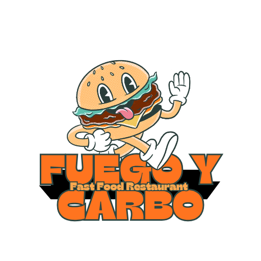

# 🍽️ Menú Digital · Fuego & Carbón

Frontend del menú digital para el restaurante **Fuego & Carbón**: una sola página (`index.html`) con HTML, CSS y JavaScript nativos, conectada a la API del catálogo mediante `fetch()`.



## ✅ Estado

**Publicado** — el menú real del restaurante se sirve desde aquí.

## 🧱 Estructura

```
pagdemodev/
├── index.html        # Menú completo (HTML + CSS + JS)
├── main.py           # API FastAPI incluida para desarrollo local
├── requirements.txt  # Dependencias de la API local
└── img.png           # Captura del menú
```

## 🚀 Ejecución local

1. Levanta la API:

```bash
python -m venv venv
source venv/bin/activate        # En Windows: venv\Scripts\activate
pip install -r requirements.txt
uvicorn main:app --reload
```

2. Abre `index.html` en el navegador. El menú carga el catálogo directamente desde la API.

## 🧩 API oficial

La fuente de verdad del catálogo vive en su propio repositorio:

- **API:** [cristianagutierrezalc/backend-fuego-carbon](https://github.com/cristianagutierrezalc/backend-fuego-carbon)
- **Prototipo inicial:** [cristianagutierrezalc/demopage](https://github.com/cristianagutierrezalc/demopage)

## 🛠️ Stack

HTML · CSS · JavaScript · Python · FastAPI
